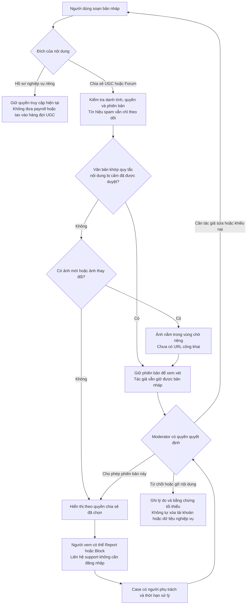

# Đề xuất luồng kiểm duyệt UGC cho bản iOS

**Ngày 16/11/2026 — bản để chủ app duyệt, chưa đổi hành vi sản phẩm.**

**Đã được thay thế về lựa chọn duyệt ảnh:** chủ app sau đó chọn kiểm tra tự động và xem trước ngay, không cần admin duyệt từng ảnh. Xem `public-image-safety-20261116.md` để biết implementation local và các điều kiện còn chờ; nội dung dưới đây là đề xuất lịch sử, không phải luồng hiện được chọn.

Đề nghị giữ bot, tốc độ gửi, nội dung lặp và ảnh trùng ở chế độ theo dõi hiện có. Bổ sung một lớp riêng cho nội dung bị cấm: giữ lại phiên bản văn bản khớp quy tắc an toàn rõ ràng; ảnh mới dùng cho bề mặt chia sẻ phải được duyệt trước lần hiển thị đầu tiên. Văn bản bình thường tiếp tục đăng ngay. Không chuyển toàn bộ bài viết sang hàng chờ.

Đây là đề xuất cần triển khai và kiểm thử rồi mới đánh dấu hạng mục UGC đạt. Apple yêu cầu có cách ngăn nội dung phản cảm được đăng, báo cáo được xử lý kịp thời, chặn người lạm dụng và kênh liên hệ công khai; chỉ có nút Report và hàng đợi chưa chứng minh đầy đủ các yêu cầu đó. [Apple, Guideline 1.2](https://developer.apple.com/app-store/review/guidelines/#user-generated-content).

## Hiện tại và phần thay đổi đề nghị

Mốc đã đọc: nguồn native đã upload `830f0a6ec3029177c94e88137a8165f784c47ae4`, bản `1.0.0 (100)`. Bản chuẩn bị hiện tại có HEAD `23e66abd5a197d66fd9d2e9fbb358b160af06307`. Chưa dùng tài liệu này để khẳng định catalog database live hoặc nhân sự trực kiểm duyệt đã được xác minh.

| Luồng | Bằng chứng hiện tại | Đề nghị để duyệt |
| --- | --- | --- |
| Beauty, Looks, Updates: tiêu đề/caption và bình luận | Có quét từ khóa, nhưng bản thay thế mới ghi case/cảnh báo mà không giữ bài mới; quyết định giữ của con người vẫn được bảo vệ. | Tách quy tắc nội dung bị cấm khỏi tín hiệu spam. Chỉ quy tắc an toàn có ngữ cảnh và phạm vi được duyệt mới giữ phiên bản trước khi chia sẻ. Bài không khớp đi tiếp ngay. |
| Ảnh bài đăng, avatar, cover, logo và media khác được hiển thị cho người khác | Có kiểm tra quyền, đường dẫn, bytes/MIME, decode và chuẩn hóa ảnh. Dấu vân tay ảnh lặp chỉ báo động; chưa tìm thấy bộ phân loại nội dung ảnh trong đường đã rà. | Với lựa chọn chưa dùng dịch vụ phân loại mới: ảnh mới chờ người duyệt trước khi xuất hiện trên bề mặt chia sẻ. Tái sử dụng đúng bytes đã được duyệt có thể đi tiếp nếu approval còn hiệu lực và đúng phạm vi. Thay ảnh hoặc đổi bytes phải kiểm tra lại. |
| Forum topic/reply/chat | Có quyền Owner, giới hạn gửi, báo cáo, chặn cá nhân và công cụ moderator; đường ghi được rà chèn văn bản trực tiếp. | Dùng cùng bộ lọc văn bản bị cấm trước khi ghi phiên bản hiển thị. Giữ nguyên quyền Owner, tốc độ gửi và luồng văn bản bình thường; không đưa chat thông thường vào duyệt thủ công. |
| Báo cáo nội dung đang hiển thị | Có case, bằng chứng, quyết định bài viết, công cụ Forum và support. Ghi “resolved” trong support không tự chứng minh nội dung đã được gỡ. | Mọi loại UGC phải có hành động đúng nguồn: giữ nguyên/gỡ nội dung, hạn chế quyền đăng hoặc chuyển xử lý. Chỉ đóng case sau khi kiểm tra trạng thái nội dung thực tế và lưu kết quả. |

Các loại chia sẻ bao gồm public feed, hồ sơ công khai, nội dung gửi tới followers/người khác và Forum dành cho Owner. Bản nháp chỉ mình tác giả thấy vẫn là bản nháp. Nếu có luồng nhắn tin khác trong candidate cuối, phải kiểm kê riêng; không mặc định cho phép nó bỏ qua an toàn.

## Luồng đề nghị

Văn bản và ảnh là hai phần của cùng một phiên bản: không xuất bản caption/thumbnail của bài đang chờ ảnh nếu chúng làm lộ nội dung chưa được phép. Sửa một bài đã đăng tạo phiên bản mới; phiên bản cũ chỉ được giữ hiển thị khi chính nó còn được phép. Thay caption, đổi visibility hoặc gọi RPC trực tiếp không được mở khóa một quyết định giữ trước đó.

## Các kiểm soát cần có trong bản triển khai

1. **Quy tắc văn bản có phạm vi hẹp.** Dùng quy tắc được duyệt cho nội dung cấm như đe dọa trực tiếp, khai thác trẻ em hoặc nội dung tình dục rõ ràng; xét ngữ cảnh tiếng Anh/Việt. Không dùng riêng một từ phổ thông để kết luận vi phạm. Từ khóa mơ hồ, ảnh trùng, số điện thoại, URL lặp và bot vẫn tạo tín hiệu để người xem xét. Không tự đình chỉ tài khoản từ một lần khớp.
2. **Ảnh chờ thực sự riêng.** Quyền Storage và API phải ngăn người khác lấy ảnh/thumbnail gốc trước approval; chỉ ẩn thẻ feed là chưa đủ. Moderator chỉ mở asset của case bằng quyền được cấp. Approval gắn với hash bytes, phiên bản và mục đích hiển thị; chỉnh sửa, thu hồi hoặc gỡ phải vô hiệu hóa đúng phiên bản/cache liên quan. Không xóa hàng loạt ảnh cũ chỉ vì thêm cơ chế mới.
3. **Quyết định có thể truy vết.** Lưu ai quyết định, nguồn nội dung, phiên bản/hash, lý do, thời điểm và trạng thái sau xử lý. “Cho phép” không được khôi phục bản đã xóa, xuất bản bản mới hơn chưa được duyệt hoặc bỏ qua quyền tác giả/salon. Người duyệt chỉ có `reports.read/update` không được tự nhận quyền đình chỉ tài khoản; quyền Forum và quyền platform tiếp tục tách biệt.
4. **Report và Block hoạt động tại nơi xem nội dung.** Báo cáo phải trỏ đúng phiên bản/nội dung, có biên nhận và đường theo dõi. Block cá nhân chặn tương tác xã hội theo cơ chế hai chiều hiện có; không sửa quyền nghiệp vụ. Moderator có quyền phù hợp mới hạn chế người lạm dụng ở phạm vi dịch vụ. Case bình luận/review/experience cần đường gỡ đúng nguồn, không chỉ đổi nhãn support thành resolved.
5. **Tác giả xử lý được nhầm lẫn.** Hiện trạng thái “Chờ xem xét”, lý do theo nhóm chính sách và cách sửa/khiếu nại; giữ Save/Cancel và nội dung đang soạn. Sửa xong phải kiểm tra lại phiên bản, không tự bỏ hold cũ. Không tự đăng khi hết thời gian chờ. Theo dõi tỷ lệ khớp nhầm để sửa quy tắc; ngoại lệ có phạm vi và được ghi lại, không mở miễn kiểm tra toàn bộ tài khoản.

Không chọn hoặc cấu hình nhà cung cấp AI trả phí, không mở API permission mới trong đề xuất này. Nếu muốn ảnh được xử lý tự động thay cho hàng chờ con người, phải đánh giá riêng nhà cung cấp, dữ liệu gửi đi, chi phí, độ chính xác và phương án lỗi trước khi chọn.

## Tách UGC khỏi payroll, tax và dữ liệu riêng

Chỉ đưa nội dung được gửi đến bề mặt chia sẻ đã liệt kê vào cơ chế UGC. Phiếu lương, hồ sơ thuế, tài khoản ngân hàng, receipt, ghi chú khách, tệp support riêng và bản export tiếp tục chịu ACL/lifecycle hiện tại. Không quét hoặc sao chép chúng sang hàng đợi xã hội chỉ vì trường dữ liệu cũng tên `body`, `image` hoặc `attachment`.

Một ảnh được đăng công khai chứa dữ liệu cá nhân vẫn có thể được kiểm duyệt đúng bài đăng; việc đó không cấp cho moderator quyền mở hồ sơ payroll/tax gốc. Case lưu bằng chứng tối thiểu, không toàn bộ lịch sử salon/khách. Chủ salon không tự có quyền duyệt nội dung của người khác trên toàn nền tảng. Chặn xã hội không hủy membership, không thay quyền xem lương/thuế và không thay số liệu tài chính.

UGC vẫn thuộc người dùng. Reylumi vận hành nền tảng theo quyền sử dụng đã được xác lập trong Terms; moderator không được ghi rằng Reylumi sở hữu toàn bộ ảnh của người dùng hoặc rằng approval chứng minh tác giả có mọi quyền đối với ảnh.

## Người xử lý, thời hạn và liên hệ

**Đề xuất vận hành, chưa phải cam kết đã hoạt động:** Reylumi chỉ định một người chịu trách nhiệm và một người dự phòng; phân quyền hiện có theo nhiệm vụ. Người phụ trách xác nhận thời gian trực và cách chuyển ca trước khi mở luồng. Support tiếp nhận/trao đổi; moderator quyết định nội dung; người có quyền đình chỉ mới được quyết định hạn chế tài khoản.

| Loại case | Mục tiêu nội bộ đề nghị | Khi chưa xử lý kịp |
| --- | --- | --- |
| Nguy cơ nghiêm trọng, ví dụ đe dọa trực tiếp hoặc an toàn trẻ em | Triage trong 1 giờ khi hệ thống có người trực; ưu tiên chuyển người phụ trách ngay. Cần xác nhận khả năng bao phủ ngoài giờ, không tự hứa trực 24/7. | Giữ phiên bản chưa đăng; báo người dự phòng. Với nội dung đang hiển thị, người có quyền áp dụng biện pháp hạn chế phù hợp và ghi lý do. |
| Báo cáo thông thường, ảnh chờ và khiếu nại | Người xem xét ban đầu trong 24 giờ; xử lý hoặc gửi cập nhật trong 72 giờ. | Cảnh báo case quá hạn và đổi người xử lý; không tự approve, không tự đóng case. |

Các con số trên là phương án để chủ app chọn theo nhân lực; Apple không ấn định các mốc này trong Guideline 1.2. Chưa đủ nhân lực thì không được mô tả “xử lý kịp thời” như một năng lực đã chứng minh. Chỉ xuất bản thời hạn hỗ trợ sau khi chủ app xác nhận và đội vận hành thực hiện được.

Kênh công khai: `/support`, `/contact-support`, `support@reylumi.com`. Trang hỗ trợ và biên nhận phải hướng dẫn rõ cách báo cáo nội dung, khiếu nại và tiếp tục hội thoại; không yêu cầu mật khẩu hoặc OTP. Chưa gửi email/tin nhắn hay tạo case thật trong bước đề xuất.

## Quyết định cần chủ app chốt

Đề nghị duyệt **bộ lọc an toàn hẹp cho văn bản + duyệt ảnh mới trước khi chia sẻ**, giữ tín hiệu spam ở monitor-only. Đây là thay đổi có chủ đích so với việc từ khóa hiện chỉ báo động; chưa được triển khai bằng tài liệu này. Đồng thời chỉ định người phụ trách/dự phòng và xác nhận mục tiêu xử lý phù hợp với ca trực. Nếu không chọn chờ duyệt ảnh, cần chốt một phương án lọc ảnh khác có bằng chứng trước khi đánh dấu sẵn sàng gửi Apple.

Sau khi luồng được chấp thuận: lập patch riêng, kiểm thử dữ liệu mẫu/ảnh an toàn, bypass qua RPC/Storage, sửa bài, chờ khi offline, nhầm lẫn/khiếu nại, report → quyết định → trạng thái public, và quyền payroll/tax. Kiểm chứng candidate trên iPhone/iPad; không dùng test tạo UGC thật hoặc gửi thông báo production để thay cho sandbox.

## Bằng chứng đã dùng

- `supabase/migrations/20261029021000_social_monitor_only.sql:127–247`: từ khóa, tín hiệu ảnh và bảo toàn quyết định của con người.
- `supabase/migrations/20261103180000_owner_forum.sql:83–105,179–281`; các patch `20261104010000` và `20261109220000`: quyền, đường ghi, report và moderation Forum.
- `lib/normalize-image.ts`, `lib/normalize-stored-image.ts`, `lib/beauty.ts:1036–1079`, `lib/salon-profile.ts:1844–1867`: kiểm tra media hiện tại.
- `app/(app)/admin/post-safety/actions.ts`, `app/(app)/admin/post-safety/spam/actions.ts`, `app/(app)/admin/reports/report-case-view.tsx`: công cụ đang có; staffing/SLA chưa xác minh.
- Audit nguồn cố định: `C:/Reylumi/artifacts/ios-legal-readiness-20261114/ugc-audit/findings.json` và `source-manifest.json`.
- [Apple App Review Guidelines 1.2](https://developer.apple.com/app-store/review/guidelines/#user-generated-content), đọc lại 16/11/2026. Thiết kế này là đề xuất kỹ thuật/vận hành, không bảo đảm Apple chấp thuận.
